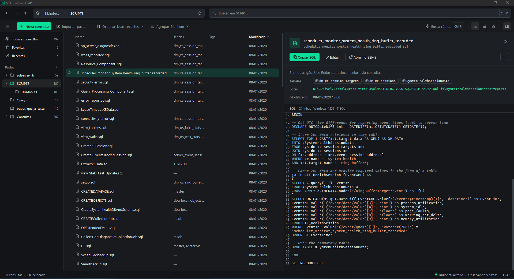
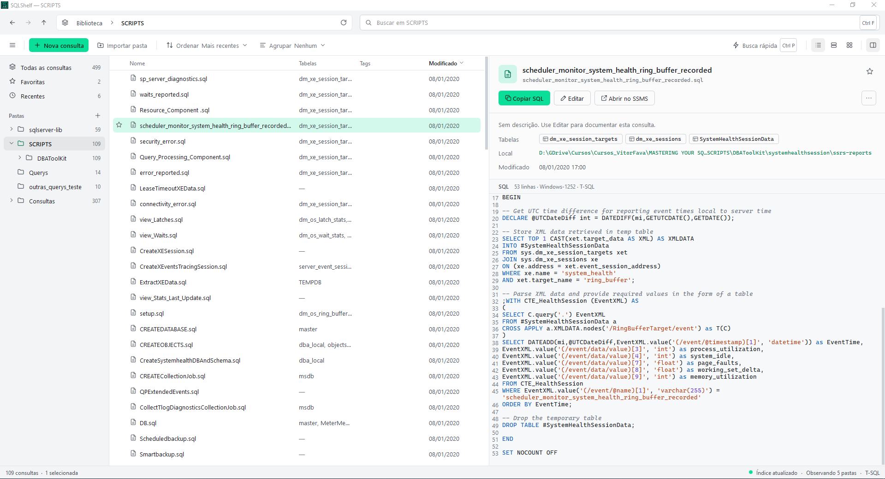

<p align="center">
  
</p>

<p align="center">
  <strong>Open-source desktop SQL query manager</strong><br/>
  Organize, describe, categorize and search your <code>.sql</code> files by content, table, field or tag.
</p>

<p align="center">
  <a href="https://github.com/raphamaster/SQLShelf/releases/latest">
    
  </a>
  
  
  
</p>

---

<p align="center">
  
</p>

<p align="center">
  
</p>

---

## What is SQLShelf?

If you work with SQL — SQL Server, PostgreSQL, MySQL, MariaDB, Oracle or BigQuery — and accumulate dozens (or hundreds) of `.sql` files scattered across folders, SQLShelf is your library. It scans any folder, indexes all your queries and gives you instant full-text search — including searches by table name, column name or tag.

Your files stay exactly as they are. SQLShelf only adds an optional metadata block at the top of each file (as a SQL comment), so files remain valid and fully executable in SSMS or any other tool.

---

## Features

**Search**
- Full-text search across names, descriptions, SQL and the tables it uses, ignoring accents and case
- Closest matches first: queries whose name holds every searched word, then those whose description does, then the rest — a script that merely repeats a word no longer outranks the query named after it
- Prefix filters: `table:orders`, `col:customer_id`, `tag:report`, `date:15/06/2026`, `dialect:oracle` — each one becomes a chip in the search field
- Combine filters freely — e.g. `table:orders tag:monthly`
- Search the whole library or only the folder you are in; sort the results by relevance, name or date
- Quick search (`Ctrl+P`): open a query or run an action from the keyboard; `Ctrl+C` copies a query's SQL without opening it
- Right-click a table in the details panel to find every query that uses it

**Browsing and organization**
- Multi-folder library — import as many folders as you need; each one shows its subfolders as a tree, with query counts
- Favorites, Recent and the most used tags in the sidebar
- Three views of the list: Details (name, tables, tags, modified), Content (with the description) and Grid (cards with a thumbnail of the SQL)
- Group by date or by folder; groups fold
- Back, Forward and Up (`Alt+←` `Alt+→` `Alt+↑`) and a clickable breadcrumb, like a file explorer
- Inline tags with chip editor and suggestions from the library
- Mark queries as favorites with one click

**Editor**
- SQL syntax highlighting in the query's dialect, with line numbers and current-line highlight
- Responsive loading for large SQL scripts; expensive parsing and database I/O run outside the UI thread
- Details panel: title, description, tags, tables, folder and last change — read/edit mode; the edit form also sets the author and the dialect
- Open in SSMS (the default application outside Windows), Reveal in Explorer, copy the file or folder path
- Copy SQL content without the frontmatter block
- Duplicate a query as the start of a new one (`Ctrl+D`)

**SQL dialects**
- T-SQL, PostgreSQL, MySQL, MariaDB, Oracle (PL/SQL) and BigQuery
- Each query's dialect is read from its syntax (`GO` and `[brackets]`, `::` casts, backtick names, `FROM DUAL`, `` `project.dataset.table` ``…); a query with no clear sign is generic SQL
- Wrong guess? Pick the dialect in the edit form: it is saved as `dialect:` in the metadata block and always wins
- Tables and columns are indexed, the diagram is drawn and the SQL is coloured in that dialect; the editor and the status bar show which one, and why
- Filter by it: `dialect:oracle` (also `dialect:plsql`, `dialect:sqlserver`, `dialect:pg`…)

**Query diagram**
- A _Diagram_ tab next to the SQL draws what the query uses: tables, temp tables, CTEs, derived tables and the result, linked by their joins and data flow (`INTO`, `INSERT`, `UPDATE`, `MERGE`)
- Read from the query text alone — no database connection; each table shows only the columns the query mentions, and how they are used
- Multi-statement scripts (`GO`, `BEGIN … END`): see every statement or pick one
- Click a table to highlight its connections; double-click or _Go to SQL_ selects it in the editor; search all queries that use it
- Redraws as you edit, keeping the last good drawing while the text does not parse
- Open it in a window of its own, with a legend, and export it as PNG or SVG, or copy it as an image

**File-first philosophy**
- Your `.sql` files on disk are always the source of truth
- Metadata lives in a YAML comment block at the top of each file — not in a proprietary database
- The search index (SQLite) is fully regeneratable and disposable
- Files remain valid and executable in SSMS after any SQLShelf operation

**UI**
- Dark and light themes (live switching)
- English, Portuguese (PT-BR) and Spanish interface
- The menus live under ☰ in the command bar; _View → Show Menu Bar_ brings the classic menu bar back
- File watcher: every library folder is watched, and the index updates automatically when files change on disk
- System tray: close minimizes to tray; double-click to restore
- Windows autostart option (_Edit → Preferences_)
- Status bar: query and result counts, indexing progress and the open query's dialect
- Statistics dialog (_Help → Statistics_): totals for queries, tags, tables and columns
- Reports dialog (_Help → Reports_): most-accessed queries and tags, based on an access log
- Update check (_Help → Check for Updates_), also run quietly at startup

---

## Download

| Platform | Installer | Portable (no install) |
|----------|-----------|----------------------|
| **Windows 10/11 x64** | [SQLShelf-1.4.1-windows-x64-setup.exe](https://github.com/raphamaster/SQLShelf/releases/latest) | [SQLShelf-1.4.1-windows-x64-portable.zip](https://github.com/raphamaster/SQLShelf/releases/latest) |
| **Linux x86_64** | [SQLShelf-1.4.1-linux-x86_64.AppImage](https://github.com/raphamaster/SQLShelf/releases/latest) | [SQLShelf-1.4.1-linux-x86_64-portable.zip](https://github.com/raphamaster/SQLShelf/releases/latest) |

> **Portable:** extract the zip anywhere and run `SQLShelf.exe` (Windows) or `./SQLShelf` (Linux) — no installation required.

> **Windows note:** Windows SmartScreen may show a warning on first launch because the app is not yet code-signed. Click **"More info → Run anyway"** to proceed. The app is open source — you can review every line of code here.

---

## Running from source

```bash
git clone https://github.com/raphamaster/SQLShelf.git
cd SQLShelf

python -m venv venv
# Windows:
venv\Scripts\activate
# Linux/macOS:
source venv/bin/activate

pip install -r requirements.txt
python main.py
```

**Requirements:** Python 3.12+

---

## How metadata works

When you add a title, description or tags to a query, SQLShelf writes a YAML block at the very top of the `.sql` file, wrapped in a SQL block comment:

```sql
/* ---
title: Monthly Sales Report
description: Aggregates revenue by product category for the current month
tags: [report, sales, monthly]
author: Raphael Franco
dialect: postgres
created: 2025-01-15
updated: 2025-06-14
--- */

SELECT
    category,
    SUM(revenue) AS total_revenue
FROM sales
GROUP BY category
```

The file stays 100% valid SQL. Open it in SSMS, run it, edit it — SQLShelf will pick up the changes automatically.

`dialect:` is optional: without it, SQLShelf reads the dialect from the SQL itself. It accepts the usual names — `tsql`, `SQL Server`, `postgres`, `pg`, `mysql`, `mariadb`, `oracle`, `PL/SQL`, `bigquery` — and keeps the spelling you wrote.

---

## Tech stack

| Layer | Technology |
|-------|-----------|
| Language | Python 3.12 |
| UI | PySide6 (Qt 6), Fusion style + QPalette + QSS generated from design tokens |
| SQL Editor | `QPlainTextEdit` + `QSyntaxHighlighter` |
| Search index | SQLite FTS5 (stdlib `sqlite3`) |
| Metadata | YAML frontmatter via PyYAML |
| File watcher | watchdog |
| SQL parsing | sqlglot, in each query's dialect |
| Packaging | PyInstaller + Inno Setup (Windows) / AppImage (Linux) |

---

## Keyboard shortcuts

| Shortcut | Action |
|----------|--------|
| `Ctrl+O` | Import folder |
| `Ctrl+N` | New query |
| `Ctrl+D` | Duplicate query |
| `Ctrl+P` | Quick search |
| `Ctrl+S` | Save query |
| `Ctrl+F` | Focus search bar |
| `Ctrl+E` | Toggle edit mode |
| `Ctrl+A` | Select all (view mode) |
| `Ctrl+Shift+C` | Copy SQL (without the frontmatter block) |
| `Ctrl+Shift+F` | Copy an empty frontmatter block to the clipboard |
| `Alt+←` / `Alt+→` / `Alt+↑` | Back / Forward / Up |
| `Alt+P` | Show or hide the details panel |
| `Ctrl+Shift+D` | Switch between the SQL and Diagram tabs |
| `Ctrl+0` | Fit the diagram |
| `Ctrl+=` / `Ctrl+-` | Zoom the diagram in / out |
| `Esc` | Cancel editing; in the diagram, clear the selection, then close the diagram window |
| `F1` | Help |
| `Alt+F4` | Quit (exits, does not minimize to tray) |

---

## Development

```bash
pip install -r requirements-dev.txt   # ruff, black, mypy

pytest          # run tests
ruff check .    # lint
black .         # format
mypy            # type check (paths come from pyproject.toml)
```

Tests cover the core — frontmatter, encoding, dialects, SQL objects, statement splitting, the query graph and its layout, search, the index — and the widgets and main window, which run offscreen (`QT_QPA_PLATFORM=offscreen`), so no display is needed.

### Building

```powershell
.\build_app.ps1                               # Windows: dist\SQLShelf\ and the portable zip
iscc /DAppVersion=X.Y.Z installer\sqlshelf.iss  # optional: the installer (Inno Setup 6)
```

`build_app.ps1` runs PyInstaller with `sqlshelf.spec`, also under Windows PowerShell 5.1. Releases are built by GitHub Actions when a `v*` tag is pushed: the Windows installer and portable zip, and the Linux AppImage and portable zip.

---

## License

GNU General Public License v3.0 — see [LICENSE](LICENSE).

---
